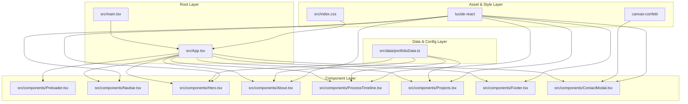

# Architecture Graph

## Architecture Evaluation
- **Simplicity Score**: 9/10 — Clean top-down composition.
- **Maintainability Score**: 9/10 — Low component coupling.
- **Architecture Score**: 9/10 — Clear separation of presentation, data, and motion layers.
