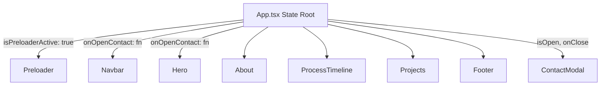

# Component Graph & Render Hierarchy

## Prop Flow Contracts
- `Navbar`: receives `onOpenContact` -> invokes on button click.
- `Hero`: receives `onOpenContact` -> invokes on "Hire Me" / "Get in Touch" buttons. Manages background video lifecycle via `IntersectionObserver` (auto-pause when scrolled offscreen).
- `ContactModal`: receives `isOpen` (boolean) and `onClose` (callback). Delivers contact form messages directly to `portfolioData.contact.email` via FormSubmit AJAX API.
