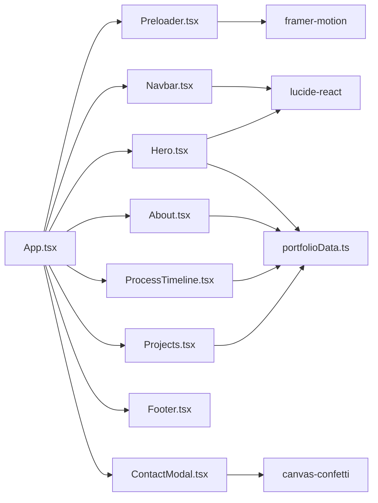

# Dependency Graph

## Critical Dependencies Mapping
- **Hub Module**: `src/data/portfolioData.ts` (consumed by 4 presentation components).
- **Controller Module**: `src/App.tsx` (orchestrates modal state and preloader sequence).
- **Circular Dependencies**: 0 circular dependencies detected.
