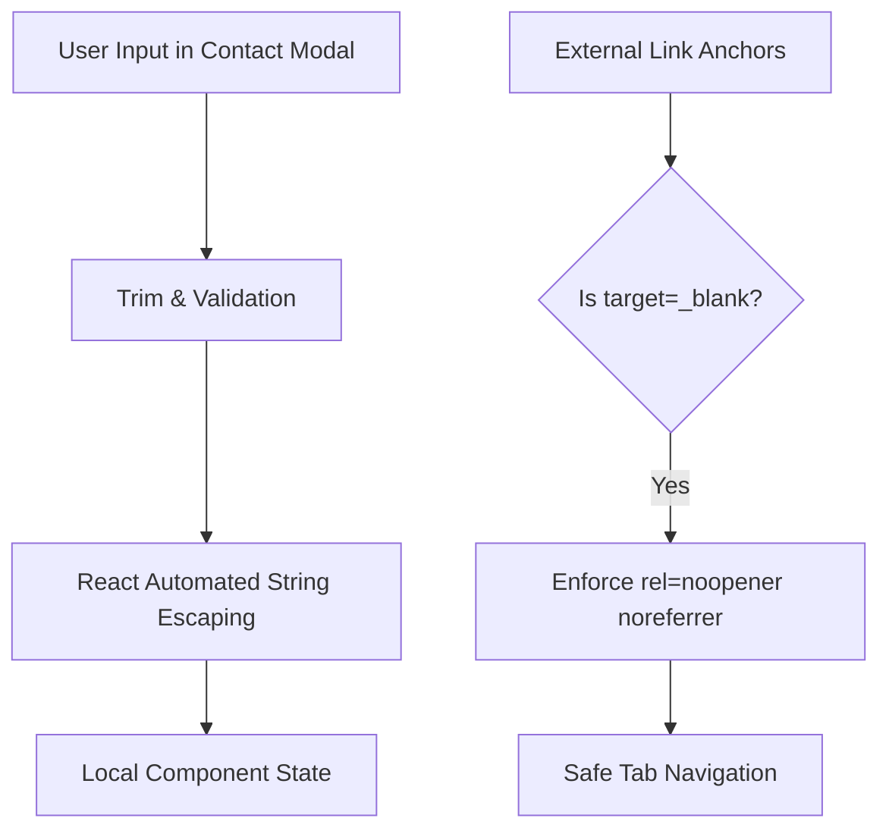

# Security Graph & Attack Surface Analysis

## Security Scores
- **Simplicity**: 10/10 — Zero direct API exposure.
- **Maintainability**: 9.5/10 — React automated escaping protects inputs.
- **Security Score**: 9.5/10 — High static compliance.
