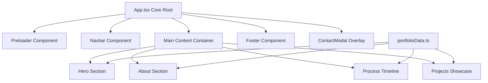

# System Architecture

## Architecture Pattern
`portfolio-new` follows a Single-Page Application (SPA) architecture built with **React 19**, **TypeScript**, **Vite 8**, **Tailwind CSS v4**, and **Framer Motion 12**. State is managed locally via React Hooks (`useState`), and static configuration is centralized in `src/data/portfolioData.ts`.

## Component Lifecycle & Rendering Model

## State Management Lifecycle
1. **Preloader State (`isPreloaderActive`)**: Defaults to `true`. Gates main UI interactions until countdown finishes, setting `isPreloaderActive` to `false`.
2. **Contact Modal State (`isContactOpen`)**: Managed centrally in `App.tsx` and passed via `onOpenContact` callback props to `Navbar` and `Hero`.

## Data Flow Architecture
- All content (personal info, tech stack, project list, timeline steps) is defined as strongly typed objects in `src/data/portfolioData.ts`.
- Components import `portfolioData` directly, ensuring zero prop-drilling for static data while keeping components decoupled.

## Storage Architecture
- Currently 100% client-side static asset rendering with zero persistent database dependency in the frontend bundle.
- Form submissions in `ContactModal` simulate API dispatch with local confetti trigger via `canvas-confetti`.
